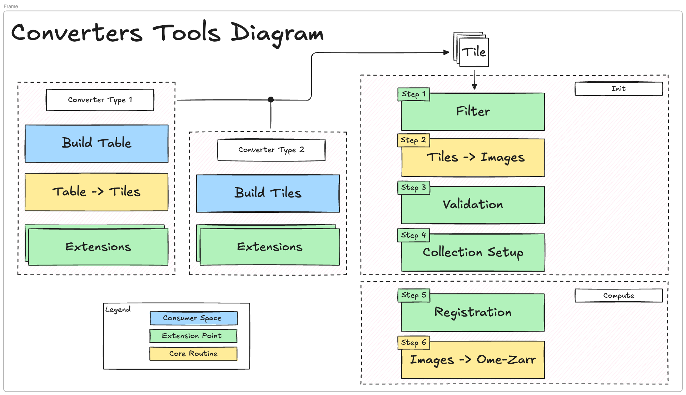

# ome-zarr-converters-tools

[](https://github.com/BioVisionCenter/ome-zarr-converters-tools/raw/main/LICENSE)
[](https://pypi.org/project/ome-zarr-converters-tools)
[](https://python.org)
[](https://github.com/BioVisionCenter/ome-zarr-converters-tools/actions/workflows/ci.yml)
[](https://codecov.io/gh/BioVisionCenter/ome-zarr-converters-tools)

A Python library that provides shared utilities for building OME-Zarr image converters. It handles tile management, image registration, filtering, validation, and writing OME-Zarr images and HCS plates.

Just want to convert your files? If your microscope is one of Opera/Operetta, Yokogawa CV8000/CQ3K, ScanR, ImageXpress, Leica LIF, Zeiss CZI, Nikon ND2 or TIFF folders, use the ready-made converter listed under [converters built on this library](https://BioVisionCenter.github.io/ome-zarr-converters-tools/stable/guides/converters/). This package is the library those converters share; read on if you are writing one for a format that is not covered yet.

## Features

1. **Abstraction layer** for building OME-Zarr images and HCS plates from microscope metadata and image data
2. **Customizable pipeline** for filtering, validating, registering, and tiling images
3. **Python API** for building custom converters, with optional [Fractal](https://fractal-analytics-platform.github.io/fractal-server/) integration for parallel processing
4. **Flexible input**: parse tiles from DataFrames or construct them programmatically

### Architecture Diagram



## Getting Started

Install via pip:

```bash
pip install ome-zarr-converters-tools
```

For converting data stored on S3 (`s3://` URLs), install the `s3` extra:

```bash
pip install "ome-zarr-converters-tools[s3]"
```

### Quickstart

Convert a tile table (one row per tile: stage position, size, and image file; the
columns are described in the [HCS plates tutorial](https://BioVisionCenter.github.io/ome-zarr-converters-tools/stable/getting_started/0_hcs_plates/#step-1-prepare-the-tile-table))
into a single OME-Zarr image:

```python
import pandas as pd

from ome_zarr_converters_tools import (
    AcquisitionDetails,
    AutoTiling,
    ChannelInfo,
    ConverterOptions,
    OverwriteMode,
    StagePositionCorrections,
    WriterMode,
    build_default_registration_pipeline,
    single_images_from_dataframe,
    tiled_image_creation_pipeline,
    tiles_aggregation_pipeline,
)

acq = AcquisitionDetails(
    channels=[ChannelInfo(channel_label="DAPI")],
    xy_pixel_size=0.65,  # micrometers
    z_spacing=1.0,
)
tiles = single_images_from_dataframe(
    tiles_table=pd.read_csv("tiles.csv"), acquisition_details=acq
)
options = ConverterOptions()
tiled_image = tiles_aggregation_pipeline(
    tiles=tiles, converter_options=options, resource="/path/to/image/files"
)[0]
tiled_image_creation_pipeline(
    zarr_url="/path/to/output.zarr",
    tiled_image=tiled_image,
    registration_pipeline=build_default_registration_pipeline(
        StagePositionCorrections(), AutoTiling()
    ),
    converter_options=options,
    writer_mode=WriterMode.BY_FOV,
    overwrite_mode=OverwriteMode.NO_OVERWRITE,
    resource="/path/to/image/files",
)
```

See the [tutorials](https://BioVisionCenter.github.io/ome-zarr-converters-tools/stable/getting_started/0_hcs_plates/) for HCS plates, custom image loaders, and Fractal tasks, and [writing a converter](https://BioVisionCenter.github.io/ome-zarr-converters-tools/stable/guides/writing_a_converter/) for the full path from a parser to a packaged task.

## Documentation

For detailed documentation, tutorials, and API reference, visit the [official documentation](https://BioVisionCenter.github.io/ome-zarr-converters-tools/).

The documentation includes:

- [HCS plates](https://BioVisionCenter.github.io/ome-zarr-converters-tools/stable/getting_started/0_hcs_plates/) — converting plate-based microscopy data
- [Single images](https://BioVisionCenter.github.io/ome-zarr-converters-tools/stable/getting_started/1_single_images/) — converting standalone images
- [Custom file formats](https://BioVisionCenter.github.io/ome-zarr-converters-tools/stable/getting_started/2_programmatic_tiles/) — building tiles in code with a custom image loader
- [Writing a converter](https://BioVisionCenter.github.io/ome-zarr-converters-tools/stable/guides/writing_a_converter/) — what a converter consists of, and how to run, test and package it
- [Converters as Fractal tasks](https://BioVisionCenter.github.io/ome-zarr-converters-tools/stable/guides/fractal_tasks/) — building parallel converters with the Fractal platform
- [Pipeline configuration](https://BioVisionCenter.github.io/ome-zarr-converters-tools/stable/guides/pipeline/) — filters, registration, tiling, and writer modes
- [API reference](https://BioVisionCenter.github.io/ome-zarr-converters-tools/stable/api/core/)
