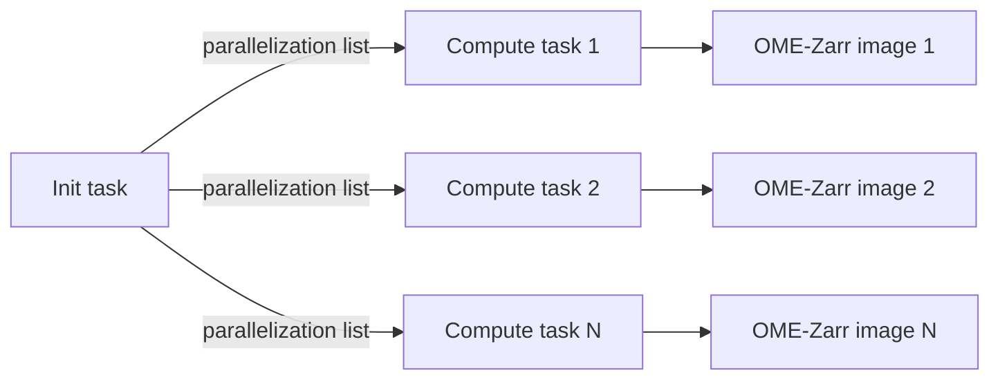

# Converters as Fractal tasks

**Package a converter as an init/compute task pair that Fractal runs in parallel.**

[Fractal](https://fractal-analytics-platform.github.io/fractal-server/) is an optional
workflow platform (web UI plus server) that runs these converters in parallel on a
cluster; everything on this site also works as plain Python. A converter plugs into
Fractal as a pair of tasks:

- An **init task** sets up the output structure and creates a parallelization list
- Multiple **compute tasks** run independently (one per image), each converting a
  `TiledImage` to OME-Zarr

This page shows how to build a converter that plugs into the Fractal workflow.

## Overview

The Fractal integration builds on the same pipeline used in the tutorials. The difference
is that the init task serializes `TiledImage` objects to JSON and the compute tasks
deserialize and process them independently.



## Init task

The init task is responsible for:

1. Building `Tile` objects from your data source (a table, a custom parser, ...)
2. Aggregating them into `TiledImage` objects
3. Setting up the OME-Zarr collection structure (plates, wells)
4. Creating a parallelization list for the compute tasks

Use `setup_images_for_conversion()`, which combines steps 3 and 4:

```python
from ome_zarr_converters_tools import (
    AcquisitionDetails,
    ChannelInfo,
    ConverterOptions,
    OverwriteMode,
    hcs_images_from_dataframe,
    setup_images_for_conversion,
    tiles_aggregation_pipeline,
)


def my_init_task(
    *,
    zarr_dir: str,
    tiles_csv_path: str,
    # ... your custom parameters
) -> dict:
    """Init task: set up plates and build parallelization list."""
    import pandas as pd

    # Step 1: Build tiles from your data source
    acq = AcquisitionDetails(
        channels=[ChannelInfo(channel_label="DAPI")],
        xy_pixel_size=0.65,
        z_spacing=5.0,
    )
    tiles_table = pd.read_csv(tiles_csv_path)
    tiles = hcs_images_from_dataframe(
        tiles_table=tiles_table,
        acquisition_details=acq,
        plate_name="MyPlate",
    )

    # Step 2: Aggregate tiles
    opts = ConverterOptions()
    tiled_images = tiles_aggregation_pipeline(
        tiles=tiles,
        converter_options=opts,
        resource="/path/to/image/data",
    )

    # Steps 3 and 4: Set up collection and build parallelization list
    parallelization_list = setup_images_for_conversion(
        tiled_images=tiled_images,
        zarr_dir=zarr_dir,
        collection_type="ImageInPlate",
        converter_options=opts,
        overwrite_mode=OverwriteMode.OVERWRITE,
    )

    return {"parallelization_list": parallelization_list}
```

The init task returns the list under the `parallelization_list` key: that is the
compound-task contract Fractal, and `exec_compound_task()` below, read.
`setup_images_for_conversion()` does two things internally:

- Calls `setup_ome_zarr_collection()` to create the plate/well structure in the Zarr store
- Serializes each `TiledImage` to JSON and returns a list of
  `{"zarr_url": ..., "init_args": ...}` dictionaries. By default the JSON travels inline
  in that list when the total payload is small (10 MiB) and is written to a temporary
  file otherwise; `TempJsonOptions.serialization` on the runtime settings forces either
  mode, and distributed runs where init and compute execute on different machines need
  `"JSON"`.

## Compute task

Each compute task receives one entry from the parallelization list and converts a single
`TiledImage`. Use `generic_compute_task()`, which handles JSON deserialization, the
registration pipeline, writing, and cleanup:

```python
from ome_zarr_converters_tools import (
    ConvertParallelInitArgs,
    DefaultImageLoader,
    ImageInPlate,
    ImageListUpdateDict,
    generic_compute_task,
)


def my_compute_task(
    *,
    zarr_url: str,
    init_args: ConvertParallelInitArgs,
) -> ImageListUpdateDict:
    """Compute task: convert one TiledImage to OME-Zarr."""
    return generic_compute_task(
        zarr_url=zarr_url,
        init_args=init_args,
        collection_type=ImageInPlate,
        image_loader_type=DefaultImageLoader,
        resource="/path/to/image/data",
    )
```

`generic_compute_task()` internally:

1. Loads the `TiledImage` from the JSON string or file (retrying while the file is not
   yet visible on a shared filesystem)
2. Builds the default registration pipeline from `converter_options`
3. Calls `tiled_image_creation_pipeline()` to write the OME-Zarr data, with
   `writer_mode` taken from `converter_options`
4. Cleans up the temporary JSON file, if one was written
5. Returns an `ImageListUpdateDict` with metadata for the Fractal image list

!!! note "Why the types are passed again"
    The `collection_type` and `image_loader_type` parameters are needed because
    `TiledImage` is generic — the concrete types must be specified when deserializing
    from JSON. Two consequences for a custom loader: one loader class per converter,
    since `image_loader_type` is a single type, and JSON-serialisable loader fields
    (paths, indices, names), since the loader travels inside the serialised
    `TiledImage`.

## Run locally

`exec_compound_task()` runs the init task once and the compute task for every entry of
its parallelization list, the way Fractal would, without a server:

```python
from ome_zarr_converters_tools import ThreadedRunner, exec_compound_task

updates = exec_compound_task(
    init_task_fn=my_init_task,
    compute_task_fn=my_compute_task,
    init_task_kwargs={"zarr_dir": "/tmp/out", "tiles_csv_path": "tiles.csv"},
    runner=ThreadedRunner(num_threads=4),
)
```

It returns the compute tasks' `ImageListUpdateDict`s in list order. The runner is the
execution strategy: `SequentialRunner()`, the default when `runner` is `None`, runs
everything in one process and is the easiest to debug; `ThreadedRunner` converts images
in parallel threads; `MultiprocessingRunner` uses processes, so the compute task must be
a picklable module-level function. The existing converters expose exactly this call as
their Python API, `convert_<format>(*, zarr_dir, acquisitions, converter_options=None,
overwrite=…, runner=None)`, which is also what their
[snapshot tests](writing_a_converter.md#step-6-test-with-snapshots) call.

## Acquisition options

When building Fractal tasks, you often want to let users override acquisition details at
runtime (pixel size, channels, filters) without modifying the init task. The
`AcquisitionOptions` model provides this. As a rule of thumb: `AcquisitionDetails` is
what your parser knows from the metadata, `AcquisitionOptions` is what the task user may
override in the Fractal UI.

```python
from ome_zarr_converters_tools import (
    AcquisitionDetails,
    AcquisitionOptions,
    ChannelInfoUI,
    FovNameFilter,
)
from ome_zarr_converters_tools.fractal import PixelSizeModel

# What the parser knows
acq = AcquisitionDetails(xy_pixel_size=0.65, z_spacing=5.0)

# What the task user typed in the Fractal form (normally a task parameter)
acq_options = AcquisitionOptions(
    channels=[
        ChannelInfoUI(channel_label="GFP", wavelength_id="488", color="Green (#00FF00)")
    ],
    pixel_info=PixelSizeModel(xy_pixel_size=0.325, z_spacing=1.0, t_spacing=1.0),
    filters=[FovNameFilter(regex="FOV_[12]")],
)

# Apply the overrides before building tiles
acq = acq_options.update_acquisition_details(acq)
```

`ChannelInfoUI` is the form-friendly twin of `ChannelInfo`: its `color` is a named menu
(`Auto`, `Blue`, `Red`, `Yellow`, `Magenta`, `Cyan`, `Gray`, `Green`, `Orange`, `Purple`,
`Teal`, `Lime`, `Amber`, `Pink`, `Navy`, `Maroon`, `Olive`, `Coral`, `Violet`, each
rendered as `"Name (#RRGGBB)"`) that is converted to the hex `ChannelInfo.color` when the
details are updated. The `filters` in the options are passed on to
`tiles_aggregation_pipeline()` by your init task.

## Custom parameter models

Converters usually need their own parameter models — a format-specific acquisition
input, an advanced-options group, and so on. Subclass `UserFacingModel` rather than
`pydantic.BaseModel` so those models behave like the ones shipped here:

```python
from pydantic import ConfigDict, Field

from ome_zarr_converters_tools import UserFacingModel


class AcquisitionInput(UserFacingModel):
    model_config = ConfigDict(title="Acquisition Input")

    path: str
    """Path to the acquisition file or directory."""

    acquisition_id: int = Field(default=0, ge=0)
    """Index used to distinguish multiplexing rounds."""
```

The base sets `use_attribute_docstrings=True`, so the attribute docstrings above become
the field descriptions shown in the Fractal web UI. This matters because
`fractal-task-tools` only enables that config globally when it is imported *before* your
models are defined — inheriting from `UserFacingModel` makes it independent of import
order. It also sets `extra="forbid"`, so a typo in a task parameter fails loudly instead
of being silently dropped. Entries in a subclass `model_config` (such as `title`) merge
with the base config rather than replacing it.

## Packaging

A converter ships as a Python package that Fractal installs and reads a task manifest
from. The layout the existing converters use, built with
[fractal-task-tools](https://github.com/fractal-analytics-platform/fractal-task-tools):

```text
src/my_converter/
  __FRACTAL_MANIFEST__.json       # generated, committed
  __init__.py
  api.py                          # convert_my_format(), see "Run locally"
  convert_my_format_init_task.py  # the init task
  compute_task.py                 # the compute task
  dev/
    task_list.py                  # declares the tasks, see below
    docs_info/                    # Markdown shown in the Fractal UI for each task
```

Each task module ends with the entry point Fractal invokes:

```python
if __name__ == "__main__":
    from fractal_task_tools.task_wrapper import run_fractal_task

    run_fractal_task(task_function=my_init_task)
```

`dev/task_list.py` declares the init/compute pair as one compound converter task:

```python
from fractal_task_tools.task_models import ConverterCompoundTask

TASK_LIST = [
    ConverterCompoundTask(
        name="Convert My Format to OME-Zarr",
        executable_init="convert_my_format_init_task.py",
        executable="compute_task.py",
        meta_init={"cpus_per_task": 1, "mem": 4000},
        meta={"cpus_per_task": 1, "mem": 4000},
        category="Conversion",
        modality="HCS",
        docs_info="file:docs_info/my_format_task.md",
    ),
]
```

`fractal-manifest create --package my_converter` then writes the manifest, with the
argument schemas generated from the task signatures and their Pydantic models, and
`fractal-manifest check --package my_converter` verifies it is up to date; the existing
converters run the check in CI. The [Fractal task
documentation](https://fractal-analytics-platform.github.io/) covers the manifest fields
and publishing, and the [converters built on this library](converters.md) are complete
examples of this layout.

### Registering input models in the manifest

Fractal tasks need to declare their input models in the task manifest. Use
`converters_tools_models()` to get the list of models provided by this library:

```python
from ome_zarr_converters_tools import converters_tools_models

# Returns a list of (package, module_path, class_name) tuples
models = converters_tools_models()
# [
#     ("ome_zarr_converters_tools", "fractal/_models.py", "AcquisitionOptions"),
#     ("ome_zarr_converters_tools", "pipelines/_filters.py", "WellFilter"),
#     ("ome_zarr_converters_tools", "models/_converter_options.py", "ConverterOptions"),
#     ...
# ]
```

These tuples can be passed directly to Fractal's manifest generation tools so that the
platform can render the correct input forms for your task.

## Next

- [Writing a converter](writing_a_converter.md) — the whole path from a parser to a
  packaged task, with testing
- [fractal-uzh-converters](https://github.com/fractal-analytics-platform/fractal-uzh-converters)
  — several Fractal tasks built with this library, one per microscope, to crib from
- [Fractal task development](https://fractal-analytics-platform.github.io/) — the
  platform's own documentation on writing and packaging tasks
- [Fractal API reference](../api/fractal.md) — `exec_compound_task()` for running an
  init/compute pair locally, the runners, and the UI-facing models
